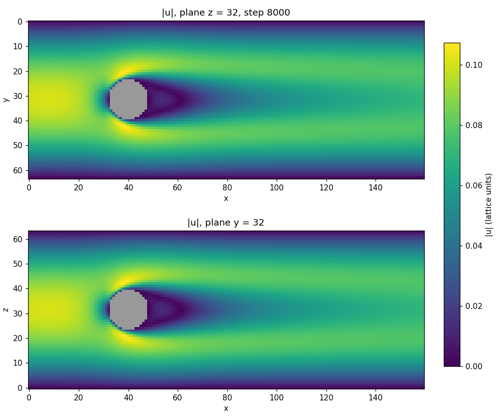

# lbm3d：三维扩展（D3Q19）

在原二维 D2Q9 求解器的基础上新增的三维版本，放在独立的 `lbm3d/` 目录里，原有二维代码没有改动。



## 和二维版本的对应关系

| | 二维（原项目） | 三维（本目录） |
|---|---|---|
| 速度模型 | D2Q9 | D3Q19 |
| 碰撞模型 | TRT（Λ = 1/4） | TRT（Λ = 1/4），参数定义相同 |
| 壁面 / 顶盖 / 入口 | Zou-He | 半程反弹（halfway bounce-back），运动壁面加动量修正 |
| 出口 | Zou-He 压力出口 | 反反弹（anti bounce-back）压力出口 |
| 障碍物 | 反弹 + 动量交换法求力 | 相同 |
| 问题类型 | 1 方腔、2 通道绕流、3 振荡小球 | 1 方腔、2 通道绕流（3 未移植） |
| CPU 数据结构 | AoS，每个格点一个对象 | SoA，两套分布函数交替 |
| 输出 | 文本 | 二进制 VTK（ParaView 可直接打开） |

三维里 Zou-He 在棱和角点上需要大量特殊处理（二维代码的角点已经是近似处理），所以边界统一换成了反弹类格式：
所有边界都在“取邻居”这一步里处理，一个函数覆盖全部情况。

## 编译

```bash
./lbm3d/compile.sh
```

- 找到 OpenMP 就编译并行版，找不到则是串行版（同一份代码）。
- 找到 CUDA 编译器（`nvcc`）就自动加入 GPU 后端，运行时加 `-gpu`。`nvcc` 不在 PATH 里时先
  `export PATH=/usr/local/cuda/bin:$PATH`。
- macOS（Apple clang + Homebrew libomp）：`./lbm3d/compile.sh -DOpenMP_ROOT=/opt/homebrew/opt/libomp`
- 双精度：加 `-DLBM3D_DOUBLE=ON`。

## 运行

```bash
./lbm3d/run.sh cavity3d 10              # 三维方腔，输出 10 帧并画切片图
./lbm3d/run.sh sphere 20 -threads=8     # 圆球绕流
./lbm3d/run.sh sphere 20 -gpu           # GPU
./build3d/lbm3d lbm3d/data/bench_cavity128.txt 0 -threads=4   # 帧数 0 = 不输出，只计时
```

选项：`-gpu`、`-threads=<n>`、`-periodic-z`（z 向周期，准二维，用于验证）、`-no-vtk`（只打印诊断量）、`-out=<目录>`。

输入文件格式与二维版相同，只是第二行写三个尺寸：

```
2                 问题类型
160 64 64         nx ny nz
300.0 8000 0.1    雷诺数  步数  速度（顶盖速度 / 入口峰值速度）
40 31 31          之后每行一个障碍物格点 x y z
...
```

雷诺数的定义沿用二维代码：方腔 `Re = u·ny/ν`，通道 `Re = (2/3·u)·ny/ν`。
障碍物文件用 `scripts/make_obstacle.py` 生成（圆球或沿 z 的圆柱）。

输出在 `lbm3d/outputs3d/`：`frame_XXXX.vtk`（速度、密度、障碍物）、`forces.txt`（受力和 Cd/Cl/Cs）。
`scripts/plotting3D.py` 画 z、y 两个中截面的速度大小；三维渲染直接用 ParaView 打开 vtk。

## 代码结构

| 文件 | 内容 |
|---|---|
| `include/Core3D.hpp` | `updateCell()`：单个格点的“迁移 + 边界 + 宏观量 + 碰撞”。CPU 和 GPU 编译的是同一个函数 |
| `src/Cpu3D.cpp` | 串行 / OpenMP 时间循环 |
| `src/Gpu3D.cu` | CUDA 时间循环，kernel 里只算线程下标然后调用 `updateCell()` |
| `src/Sim3D.cpp` | 读输入、格点分类、VTK 输出 |
| `tests/cuda_mock.hpp` | 没有 GPU 的机器上把 `Gpu3D.cu` 当普通 C++ 跑的替身（`-DLBM3D_CUDA_MOCK=ON`），只用来查逻辑 |

## 并行化要点

1. **SoA + 迁移碰撞融合**：`f[i*stride + cell]`，每步对每个格点从 `f` 读 19 个值、往 `fn` 写 19 个值，然后交换指针。
   读写分离，所以格点之间没有数据竞争，不需要锁，OpenMP 和 CUDA 都可以直接按格点并行。
2. **OpenMP**：`parallel for collapse(2) schedule(static)` 并行 (z, y)，x 方向保持内存连续；
   受力用 `reduction`；数组用同样的调度做 first-touch 初始化（对多路 NUMA 机器有用）。
3. **CUDA**：每个格点一个线程，block 为 32×4×4（x 方向宽，保证访存合并）；
   只在输出帧把宏观量拷回主机；受力只在输出帧用 `atomicAdd` 累加。
4. **格点分类**：预先把流体格点分成“体内”（18 个邻居都是流体，走无分支快速路径）和“近边界”。
5. **分布函数间距加 padding**：格点数是 2 的幂（如 128³）时，19 个分布数组会落在相同的 cache/TLB 组上，
   串行速度从约 30 MLUPS 掉到 9；`stride` 加了填充后恢复正常。这一条可以作为报告里的一个性能分析案例。
6. **存偏差量 `f − w`**：单精度下直接存 `f` 时总质量每步漂移约 2e-8，改存偏差后降到约 1e-11。

## 验证（Apple M3，单精度）

| 算例 | 结果 | 参考 |
|---|---|---|
| 准二维方腔 Re=100，64×64×4，`-periodic-z` | 竖直中线 u 与参考值最大相差 0.005 u_lid | Ghia et al. 1982 |
| 圆柱绕流 Re=20（Schäfer–Turek 2D-1），440×82×2，`-periodic-z`，D=20 格 | Cd = 5.619，Cl = 0.0115 | Cd 5.57–5.59，Cl 0.0104–0.0110 |
| 三维方腔 64³ | 关于 z 中面对称，误差 4e-8；20000 步质量变化 2e-7 | — |
| 1 线程 / 8 线程 / GPU 替身 | 输出的 vtk 文件逐字节相同 | — |
| 真实 GPU（RTX 5060）对 CPU，圆球绕流 | 速度相差 ≤ 5e-8，Cd 一致到 5 位 | — |

复现前两项：

```bash
./build3d/lbm3d lbm3d/data/cavity_q2d_re100.txt 4 -periodic-z -out=lbm3d/outputs3d
python3 lbm3d/scripts/check_cavity.py lbm3d/outputs3d
./build3d/lbm3d lbm3d/data/cylinder_re20.txt 8 -periodic-z -no-vtk
```

## 性能（Apple M3，4 性能核 + 4 能效核，128³ 方腔，100 步）

| 线程数 | MLUPS | 加速比 |
|---|---|---|
| 1 | 29 | 1.0 |
| 2 | 56 | 1.9 |
| 4 | 101 | 3.5 |
| 8 | 120 | 4.1 |

MLUPS = 每秒更新的百万格点数。8 线程里有 4 个是能效核，而且此时已接近内存带宽上限，所以不是 8 倍。

AMD Ryzen 7 9700X（8 核 16 线程），Ubuntu 24.04，g++ 13.3，同一算例，`OMP_PLACES=cores OMP_PROC_BIND=spread`：

| 线程数 | MLUPS | 加速比 |
|---|---|---|
| 1 | 24 | 1.0 |
| 2 | 48 | 2.0 |
| 4 | 93 | 3.8 |
| 8 | 157 | 6.5 |
| 16（超线程） | 146 | 6.0 |

256³（50 步）：4 线程 89，8 线程 149，16 线程 154 MLUPS。超线程基本没有收益，说明 8 核时已受内存带宽限制。
两项验证（Ghia 方腔、圆柱 Cd = 5.619）在这台机器上的结果与 M3 上相同。

### GPU：NVIDIA GeForce RTX 5060（8 GB），CUDA 13.0，驱动 580

同一台 Ryzen 7 9700X 机器，单精度，方腔算例，只计时间循环（结束前 `cudaDeviceSynchronize`），三次运行相差小于 0.1%：

| 网格 | 步数 | 显存（分布函数） | GPU MLUPS | 相对 1 线程 | 相对 8 线程 |
|---|---|---|---|---|---|
| 128³ | 2000 | 0.31 GB | 1573 | 63× | 10× |
| 256³ | 500 | 2.4 GB | 1857 | — | 12× |
| 320³ | 300 | 4.8 GB | 1887 | — | — |

对照的 CPU 数据（同样的步数）：128³ 1 线程 24.8、8 线程 152 MLUPS；256³ 8 线程 153 MLUPS。
带边界和障碍物的算例：圆球绕流 160×64×64 为 1519 MLUPS（CPU 16 线程 154）；
准二维的圆柱（440×82×2）和方腔（64×64×4）网格太小，只有 943 和 765 MLUPS。

GPU 与 CPU 的结果对比（圆球绕流，8000 步，5 帧）：速度最大相差 5e-8，密度最大相差 1.2e-7（单精度的末位，
来自 GPU 上的融合乘加），Cd 一致到 5 位有效数字。两项验证加 `-gpu` 后数值不变：方腔最大偏差 0.00491 u_lid，
圆柱 Cd = 5.619、Cl = 0.0115。

## 尚未验证 / 局限

- 三维方腔和圆球绕流没有和文献的三维基准数据定量对比。
- 显存 / 内存：单精度约 170 字节/格点（256³ 约 2.9 GB）。
- 障碍物是阶梯近似；高雷诺数或速度大于约 0.1–0.2 时会发散，程序会报错退出。
